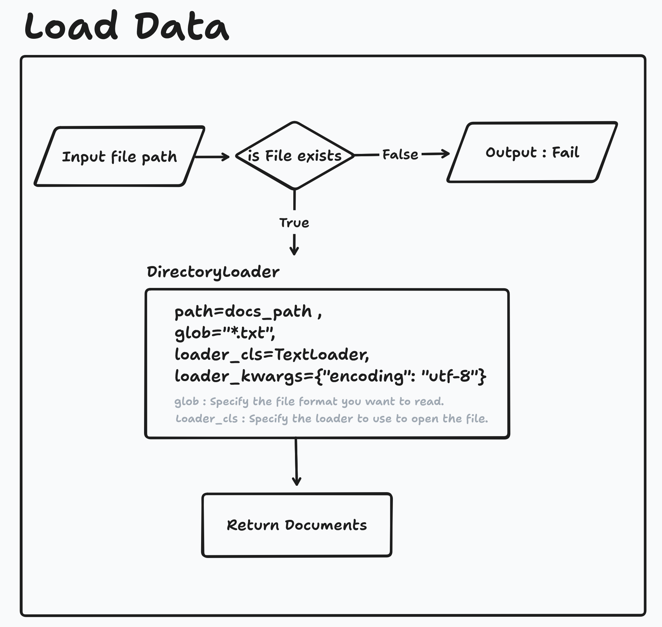

# python-rag

this project is RAG (Retrieval-Augmented Generation) purpose of this project is for education in University 

## Feature 

    - load documents file from "docs /"
    - split data to chunk with LangChain text Spliter 
    - embedding with model local embedding model from ollama  
    - Store and Create local Vector database 

## Prerequisites
    - Python 
    - Ollama 
    - Embedding Model 

## Installation

```bash
git clone https://github.com/Thanachatk/python-rag.git
cd python-rag
pip install -r requirements.txt
```
## Usage 

 1. Create Folder and Upload Document 
 2. run vector_store.py to create local database and insert function 
 3. run Ingestion.py 

## Program Pipeline


Normal RAG Pipline 

## Function Load_data



